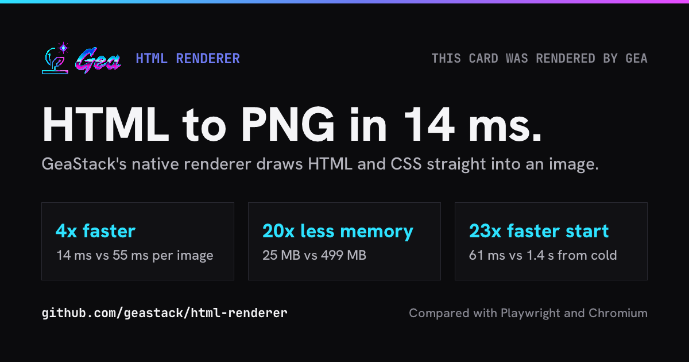

# Gea HTML Renderer

Render local HTML and CSS to PNG with GeaStack's native renderer.
The Node client keeps a native worker open for repeated captures.



This card was generated by html-renderer from
[`fixtures/promo/promo.html`](fixtures/promo/promo.html) and
[`promo.css`](fixtures/promo/promo.css):

```sh
npm run render -- fixtures/promo/promo.html --width 1200 --height 630 --out fixtures/promo/promo.png
```

## Install and render

Install the [npm package](https://www.npmjs.com/package/@geastack/html-renderer)
with Node.js 20.19 or later and render a local HTML file to PNG.

```sh
npm install @geastack/html-renderer
npx gea-html-render page.html --out page.png
```

The npm install hook downloads the matching native renderer from GitHub Releases.
If npm skips dependency scripts, the first render downloads it. The CLI defaults
to 1920 × 1080 at DPR 1. Override the viewport with `--width`, `--height`, and `--dpr`.

The release workflow builds for Apple Silicon macOS, Linux x64, and Windows x64.
Linux builds use the Ubuntu 24.04 runtime and need SDL2, libcurl, FreeType, and
libpng shared libraries. Headless capture does not require a display server.

## Node API

```js
import { openRenderer } from '@geastack/html-renderer'

const renderer = openRenderer()
try {
  await renderer.capture({ input: 'page.html', out: 'page.png', width: 1920, height: 1080 })
} finally {
  await renderer.close()
}
```

Calls to `capture()` run in order. A failed capture rejects its promise and
the worker can handle the next request. Each capture reloads the document by
default. Set `reusePage: true` to capture the already mounted page again when
the input path, viewport, and DPR match.

## Supported input

The loader handles explicitly closed elements, void elements, text, common
named entities, local images, inline styles, style blocks, linked stylesheets,
and single-source local `@font-face` rules. HTML assets resolve relative to the
HTML file. Font paths resolve relative to their stylesheet. Rendering uses
Gea's selector, property, layout, and paint support. The prototype does not
execute page JavaScript, fetch remote assets, implement browser HTML error
recovery, or handle nested CSS at-rules.

## Fixtures

[`fixtures/`](fixtures) holds 27 examples, from a one-line card to share cards,
event badges, a campaign in 6 languages and 4 sizes, sale cards and blog
covers. Most are templates that render one image per entry in their data. See
[`fixtures/README.md`](fixtures/README.md) for how to render them.


This gallery is also generated by html-renderer, with
[`fixtures/shared/gallery.mjs`](fixtures/shared/gallery.mjs).

## License

Apache-2.0. The fixture fonts are covered by their separate SIL Open Font
Licenses. See `LICENSE` and `NOTICE`.
