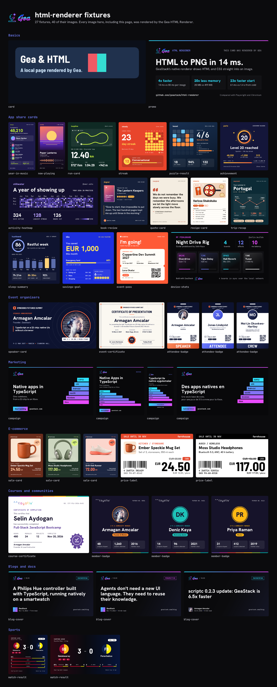

# Gea HTML Renderer

Render local HTML and CSS to PNG or MP4 with GeaStack's native renderer.
The Node client keeps a native worker open for repeated PNG captures.


This card was generated by html-renderer from
[`fixtures/promo/promo.html`](fixtures/promo/promo.html) and
[`promo.css`](fixtures/promo/promo.css):

```sh
npm run render -- fixtures/promo/promo.html --width 1200 --height 630 --out fixtures/promo/promo.png
```

## Install and render

Install the [npm package](https://www.npmjs.com/package/@geastack/html-renderer)
with Node.js 20.19 or later and render a local HTML file to PNG.

```sh
npm install @geastack/html-renderer
npx gea-html-render page.html --out page.png
```

The npm install hook downloads the matching native renderer from GitHub Releases.
If npm skips dependency scripts, the first render downloads it. The CLI defaults
to 1920 × 1080 at DPR 1. Override the viewport with `--width`, `--height`, and `--dpr`.

The release workflow builds for Apple Silicon macOS, Linux x64, and Windows x64.
Linux builds use the Ubuntu 24.04 runtime and need SDL2, libcurl, FreeType, and
libpng shared libraries. Headless capture does not require a display server.

## Export MP4

Video export is available in HTML Renderer 0.0.5 and later.

```sh
npx gea-html-render page.html --width 1280 --height 720 --start 500ms --end 4s --fps 30 --quality 9 --out page.mp4
```

The command opens the page once and advances CSS animations and local video
from time zero. It streams frames from `--start` up to but excluding `--end`.
`--end` is required, `--start` defaults to zero, and `--fps` defaults to 60.
Use `ms` or `s` suffixes for times, or pass bare values in milliseconds.

Install FFmpeg with `libx264` and put `ffmpeg` on `PATH` or set `GEA_FFMPEG`
to its executable path. The output is a silent H.264 MP4. Encoding pads each
odd viewport dimension by one pixel.

Use `--quality 1–10` to control compression. The default is **8**. Use **5**
for smaller previews or **10** to retain the most detail. Higher quality usually
means a larger file. Set `--fps` for motion smoothness and use `--width`,
`--height`, and `--dpr` to control how the page or app is rendered.

Use `<video src="clip.mp4"></video>` or a `<source src="clip.mp4">` directly
inside `<video>`. The renderer uses the `src` on `<video>` or the first child
source with a `src`. Media paths are relative to the HTML file. Playback starts
at page time zero, and the last video frame holds after the clip ends. The output
contains the rendered video frames only. Playback controls and an audio track
are outside the export path.

## Node API

```js
import { openRenderer } from '@geastack/html-renderer'

const renderer = openRenderer()
try {
  await renderer.capture({ input: 'page.html', out: 'page.png', width: 1920, height: 1080 })
} finally {
  await renderer.close()
}
```

Calls to `capture()` run in order. A failed capture rejects its promise and
the worker can handle the next request. Each capture reloads the document by
default. Set `reusePage: true` to capture the already mounted page again when
the input path, viewport, and DPR match.

Use `renderVideo()` to export a clip from Node. The time range is in milliseconds.

```js
import { renderVideo } from '@geastack/html-renderer'

await renderVideo({
  input: 'page.html',
  out: 'page.mp4',
  start: 500,
  end: 4000,
  fps: 30,
  quality: 9,
})
```

After building from source, run `npm run smoke:video` with FFmpeg and FFprobe
available to verify CSS animation and embedded video export.

## Supported input

The loader handles explicitly closed elements, void elements, text, common
named entities, local images, inline styles, style blocks, linked stylesheets,
single-source local `@font-face` rules, and `@keyframes`. HTML assets resolve
relative to the HTML file. Font paths resolve relative to their stylesheet.
Rendering uses Gea's selector, property, layout, animation, and paint support.
The prototype does not execute page JavaScript, fetch remote assets, implement
browser HTML error recovery, or handle nested conditional CSS rules.

## Fixtures

[`fixtures/`](fixtures) holds 27 examples, from a one-line card to share cards,
event badges, a campaign in 6 languages and 4 sizes, sale cards and blog
covers. Most are templates that render one image per entry in their data. See
[`fixtures/README.md`](fixtures/README.md) for how to render them.



This gallery is also generated by html-renderer, with
[`fixtures/shared/gallery.mjs`](fixtures/shared/gallery.mjs).

## License

Apache-2.0. The fixture fonts are covered by their separate SIL Open Font
Licenses. See `LICENSE` and `NOTICE`.
