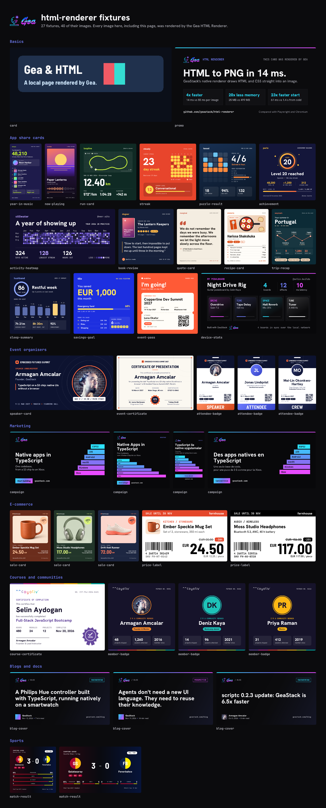

# Fixtures

Example pages and templates for the Gea HTML Renderer. Every image below,
including the gallery itself, was rendered by html-renderer.



## How they work

`card` and `promo` are plain pages. The others are templates of the kind an app
or a team generates in bulk, one image per entry in their data:

- `template.html` uses `{{key}}` for escaped values and `{{#list}}...{{/list}}`
  to repeat a block, with `{{index}}` as the item's 1-based position. An empty
  or missing list renders nothing, so lists also work as conditions.
- `<name>.css` styles the page.
- `data.json` holds `width`, `height` and `entries`. Each entry's `id` names its
  PNG, and an entry can set its own `width` and `height`.

Fonts and images that several fixtures use live in [`shared/`](shared). All
people, apps, shops and events in the data are fictional, except Armagan
Amcalar, GeaStack, Coyotiv and the football clubs in `match-result`, whose
match is made up.

## Rendering

From the repository root:

```sh
node fixtures/shared/generate.mjs fixtures/campaign
node fixtures/shared/gallery.mjs
```

[`shared/generate.mjs`](shared/generate.mjs) renders every entry of one fixture
to `dist/<fixture>/<id>.png` through a single worker.
[`shared/gallery.mjs`](shared/gallery.mjs) renders all fixtures and then
`gallery.png`, which is itself an HTML page rendered by the same renderer. Both
use a local build when there is one and the downloaded renderer otherwise.

## Visual comparison with Chromium

Build the native renderer once and install the browser pinned by the lockfile.

```sh
npm ci --ignore-scripts
npx playwright install chromium --only-shell
mkdir -p dist
npm run render -- fixtures/card/card.html --out dist/card.png
npm run visual:diff
```

The comparison renders both static pages and every entry of every template at
its declared size, including the 1920 × 1080 match-result TV layout.
The two renderers read the same local HTML,
stylesheets, images, and fonts. The Chromium screenshot removes the default
body inset. Explicit fixture margins still apply.

Open `dist/visual-diff/index.html` for the image comparisons and
`dist/visual-diff/results.json` for the measurements. Magenta marks any
difference in the four RGBA channels, including antialiasing. The report
records the browser build and host OS. Compare results from the same host
when tracking changes.

Use `npm run visual:diff -- card campaign` to compare selected fixtures.
Use `npm run visual:diff -- --strict` to exit nonzero on any differing pixel.
A capture or comparison error always exits nonzero after writing the report.

## The fixtures

**Basics**

| Fixture           | Size     | Images | What it shows                                                    |
| ----------------- | -------- | ------ | ---------------------------------------------------------------- |
| [`card/`](card)   | 480×220  | 1      | The smallest page: one stylesheet, one font, one image           |
| [`promo/`](promo) | 1200×630 | 1      | A link preview card with brand fonts, a gradient and a stats row |

**App share cards**

| Fixture                                 | Size      | Images | What it shows                                                  |
| --------------------------------------- | --------- | ------ | -------------------------------------------------------------- |
| [`year-in-music/`](year-in-music)       | 1080×1920 | 2      | Year in review: top artist, top songs, genre                   |
| [`run-card/`](run-card)                 | 1080×1080 | 2      | A run with its route, distance, pace and elevation             |
| [`streak/`](streak)                     | 1080×1080 | 2      | A learning streak with a calendar and level progress           |
| [`puzzle-result/`](puzzle-result)       | 1080×1080 | 2      | A daily puzzle result with a tile board and guess distribution |
| [`achievement/`](achievement)           | 1080×1080 | 2      | A level-up badge with XP and progress to the next level        |
| [`activity-heatmap/`](activity-heatmap) | 1200×630  | 2      | A year of practice as a 52-week heatmap                        |
| [`now-playing/`](now-playing)           | 1080×1920 | 2      | Now listening, with cover art, waveform and progress           |
| [`book-review/`](book-review)           | 1080×1080 | 2      | A book review with cover, rating and quote                     |
| [`quote-card/`](quote-card)             | 1080×1350 | 2      | A saved highlight from a book                                  |
| [`recipe-card/`](recipe-card)           | 1080×1350 | 2      | A recipe with an illustrated dish and its ingredients          |
| [`trip-recap/`](trip-recap)             | 1080×1350 | 2      | A trip with its route, stats and highlights                    |
| [`sleep-summary/`](sleep-summary)       | 1080×1080 | 2      | A weekly sleep score with a bar chart                          |
| [`savings-goal/`](savings-goal)         | 1080×1080 | 2      | A savings milestone with goal progress and a streak            |
| [`event-pass/`](event-pass)             | 1080×1080 | 2      | A conference pass with a ticket stub                           |
| [`device-stats/`](device-stats)         | 1200×630  | 2      | A GeaStack device build: boards, effects, latency              |

**Event organisers**

| Fixture                                   | Size      | Images | What it shows                                  |
| ----------------------------------------- | --------- | ------ | ---------------------------------------------- |
| [`speaker-card/`](speaker-card)           | 1200×630  | 3      | Speaker announcement, with a photo or initials |
| [`attendee-badge/`](attendee-badge)       | 900×1300  | 3      | Printed badge for speakers, attendees and crew |
| [`event-certificate/`](event-certificate) | 1600×1131 | 2      | Certificate of presentation or attendance      |

**Marketing**

| Fixture                 | Size                                     | Images | What it shows                                                       |
| ----------------------- | ---------------------------------------- | ------ | ------------------------------------------------------------------- |
| [`campaign/`](campaign) | 1080×1080, 1080×1920, 1200×627, 1600×900 | 24     | One campaign in 6 languages and 4 sizes: X, LinkedIn, square, story |

**E-commerce**

| Fixture                       | Size      | Images | What it shows                                                   |
| ----------------------------- | --------- | ------ | --------------------------------------------------------------- |
| [`sale-card/`](sale-card)     | 1080×1350 | 4      | A sale card per product from the catalogue                      |
| [`price-label/`](price-label) | 600×360   | 4      | A shelf label per product, in colour or e-paper black and white |

**Courses and communities**

| Fixture                                     | Size      | Images | What it shows                           |
| ------------------------------------------- | --------- | ------ | --------------------------------------- |
| [`course-certificate/`](course-certificate) | 1600×1131 | 2      | A Coyotiv course completion certificate |
| [`member-badge/`](member-badge)             | 1080×1080 | 3      | A Coyotiv "I'm a member" badge          |

**Sports**

| Fixture                         | Size                 | Images | What it shows                                                        |
| ------------------------------- | -------------------- | ------ | -------------------------------------------------------------------- |
| [`match-result/`](match-result) | 1080×1080, 1920×1080 | 2      | A full-time scoreboard as a social card and a broadcast-style screen |

**Blogs and docs**

| Fixture                     | Size     | Images | What it shows                                            |
| --------------------------- | -------- | ------ | -------------------------------------------------------- |
| [`blog-cover/`](blog-cover) | 1200×630 | 6      | One cover per GeaStack blog post, for 1 to 3 line titles |

## Writing a fixture

The renderer is a prototype. These limits shaped every template here:

- Text must be plain ASCII. Other characters, such as accented letters, curly
  quotes and the euro sign, render as `?`. Only `&amp;`, `&lt;`, `&gt;`,
  `&quot;`, `&apos;` and `&nbsp;` are decoded.
- Load fonts as `.ttf` with one `src` per `@font-face`, and give each weight its
  own family name. `.woff2` doesn't load.
- Give every text element an explicit `font-size` and `line-height`, and reset
  `p` margins.
- Don't close ``, and don't leave its `src` empty, even when hidden.
- Not drawn: `outline`, `box-shadow`, `letter-spacing`, `text-decoration`,
  dashed and dotted borders (they draw solid), and `background-image: url()`.
  Gradients use only their first, second and last stops.
- `width` and `height` exclude padding and border. `overflow: hidden` doesn't
  clip to rounded corners. Glyphs stop growing above about 200 px.
- These work as in a browser: `position: absolute`, `transform: rotate`,
  `opacity`, percentage widths, `text-align`, `align-items`, per-corner radii,
  `border-radius` on images, and gradients with transparent stops.
